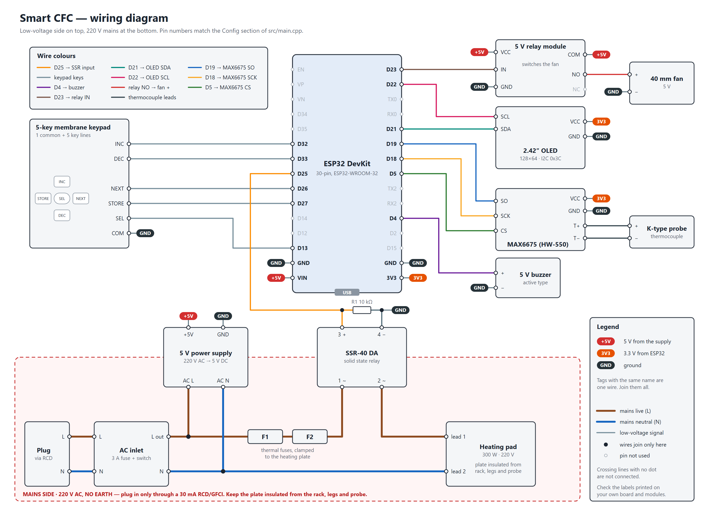

# Smart CFC — wiring

Every connection in the build, listed pin to pin so it can be redrawn in Cirkit
Designer. Pin numbers match the Config section of [src/main.cpp](../src/main.cpp).

On the 30-pin ESP32 board, GPIO 25 is the pin printed **D25**, GPIO 13 is
**D13**, and so on.



Same figure as a scalable file: [wiring-diagram.svg](wiring-diagram.svg). The
wire colours in the tables below match the figure.

---

## 1. Parts to place

| # | Part | Pins used | If Cirkit has no exact part |
|---|---|---|---|
| U1 | ESP32 DevKit, 30-pin | VIN, 3V3, GND, D4, D5, D13, D18, D19, D21, D22, D23, D25, D26, D27, D32, D33 | "ESP32 (30 pin)" |
| U2 | MAX6675 module (HW-550) | VCC, GND, SCK, CS, SO, T+, T− | "MAX6675" |
| TC | K-type thermocouple probe | +, − | drawn on the MAX6675 part, or two wires |
| U3 | 2.42" OLED 128x64, I2C | VCC, GND, SCL, SDA | any 4-pin "OLED 128x64 I2C" |
| KP | 5-key membrane keypad | COM, INC, DEC, NEXT, STORE, SEL | five pushbuttons sharing one leg |
| BZ | 5 V active buzzer | +, − | "Buzzer" |
| K1 | 5 V relay module, 1 channel | VCC, GND, IN, COM, NO | "1-Channel Relay 5V" |
| M1 | 40 mm fan, 5 V (optional) | + (red), − (black) | "Fan" |
| SSR | SSR-40 DA | 1, 2 (AC side), 3 +, 4 − (DC side) | "Solid State Relay" |
| R1 | 10 kΩ resistor | — | "Resistor" |
| PS | 220 V AC to 5 V DC supply | AC L, AC N, +5V, GND | "HLK-PM01" or any AC-DC 5 V |
| IN | AC inlet with fuse and rocker switch | L, N in; L, N out | "Fuse" + "Rocker Switch" |
| F1, F2 | Thermal fuses | 2 leads each | "Fuse" |
| HP | 300 W heating pad, 220 V | 2 leads | "Heating element" or a resistor |
| PL | 220 V plug, 2-pin | L, N | "AC source" |
| RCD | Plug-in RCD / GFCI adapter, 30 mA or lower | between the wall outlet and PL | not drawn; note it on the diagram |

---

## 2. Low-voltage wiring

### Power rails

| From | To | Wire |
|---|---|---|
| PS +5V | U1 VIN | red |
| PS +5V | K1 VCC | red |
| PS +5V | K1 COM | red |
| PS GND | U1 GND | black |
| PS GND | K1 GND | black |
| PS GND | M1 − (black lead) | black |
| U1 3V3 | U2 VCC | orange |
| U1 3V3 | U3 VCC | orange |
| U1 GND | U2 GND | black |
| U1 GND | U3 GND | black |

Every GND in the low-voltage side is one net.

### Thermocouple amplifier (MAX6675)

| From | To | Wire |
|---|---|---|
| U2 SCK | U1 D18 | yellow |
| U2 CS | U1 D5 | green |
| U2 SO | U1 D19 | blue |
| TC + | U2 T+ | — |
| TC − | U2 T− | — |

### OLED

| From | To | Wire |
|---|---|---|
| U3 SDA | U1 D21 | teal |
| U3 SCL | U1 D22 | pink |

### Keypad

| From | To | Wire |
|---|---|---|
| KP COM (common) | U1 GND | black |
| KP INC | U1 D32 | grey |
| KP DEC | U1 D33 | grey |
| KP NEXT | U1 D26 | grey |
| KP STORE | U1 D27 | grey |
| KP SEL | U1 D13 | grey |

No resistors: the firmware turns on the ESP32's internal pull-ups.

### Buzzer

| From | To | Wire |
|---|---|---|
| BZ + (long leg) | U1 D4 | purple |
| BZ − | U1 GND | black |

### Heater SSR, control side

| From | To | Wire |
|---|---|---|
| SSR terminal 3 (+) | U1 D25 | orange |
| SSR terminal 4 (−) | U1 GND | black |
| R1 10 kΩ, one leg | U1 D25 | — |
| R1 10 kΩ, other leg | U1 GND | — |

### Fan relay

| From | To | Wire |
|---|---|---|
| K1 IN | U1 D23 | brown |
| K1 NO | M1 + (red lead) | red |

K1 COM already has +5 V and M1 − already has GND from the power rails table, so
closing the relay puts 5 V across the fan.

---

## 3. Mains wiring (220 V AC)

| From | To |
|---|---|
| Wall outlet | RCD / GFCI adapter, then PL |
| PL L, N | IN inlet L, N |
| IN switched L | PS AC L |
| IN N | PS AC N |
| IN switched L | F1, lead 1 |
| F1, lead 2 | F2, lead 1 |
| F2, lead 2 | SSR terminal 1 |
| SSR terminal 2 | HP, lead 1 |
| HP, lead 2 | IN N |

```
WALL ── RCD ── PLUG ── INLET (fuse + switch) ──┬── L ──────────── PS  AC L
                                               │                   PS  AC N ── N
                                               │
                                               └── L ── F1 ── F2 ── SSR 1
                                                                    SSR 2 ── HEATING PAD ── N
```

The two thermal fuses sit **before** the SSR and are clamped against the heating
plate, so they cut the heater whatever the SSR or the ESP32 is doing.

### No earth in this build

There is no earth wire, so nothing blows the fuse if a live conductor touches
the heating plate. The plate, and anything metal touching it, would simply sit
at 220 V. These four things stand in for the missing earth, and all four are
needed:

1. **RCD / GFCI on the supply.** Plug the unit into a plug-in RCD adapter or a
   GFCI outlet rated 30 mA or lower. It needs no earth wire to work: it trips
   when current leaks out through a person instead of returning on neutral.
   Press its test button before each session.
2. **Plate isolated from every metal part you can touch.** The metal rack and
   the legs must not touch the heating plate or any mains wire. Mount the plate
   on a non-conductive, heat-proof spacer and keep an air gap or a ceramic or
   mica layer between plate and rack.
3. **Thermocouple isolated from the plate.** The probe tip is electrically
   connected to the ESP32. Put a layer of Kapton tape or mica between the bead
   and any metal, so a live plate cannot reach the keypad or the USB port.
4. **Every mains joint sleeved and strain-relieved.** Heat-shrink or
   fibreglass sleeve over each crimp and fuse lead, and clamp the cable so a
   tug cannot pull a live wire loose inside the box.

**Do not connect an earth terminal to neutral** to make up for the missing
earth. If the neutral ever opens, every "earthed" part becomes live.

If an earthed outlet becomes available later, use a 3-pin plug and bond the
plate, rack and legs to earth. That is still the better protection.

---

## 4. Whole system at a glance

```
                      ┌──────────────── ESP32 (U1) ────────────────┐
 K-type probe ─ MAX6675 ─ SCK D18 · CS D5 · SO D19                  │
                 OLED ─── SDA D21 · SCL D22                         │
               Keypad ─── INC D32 · DEC D33 · NEXT D26              │
                          STORE D27 · SEL D13 · COM GND             │
               Buzzer ─── D4                                        │
        SSR input 3/4 ─── D25 (+10 kΩ to GND) ──► heating pad 220 V │
          Relay K1 IN ─── D23 ──► fan 5 V                           │
                      └────────────────────────────────────────────┘
     5 V supply ─► VIN, relay VCC, relay COM        3V3 ─► MAX6675, OLED
```

---

## 5. Check these on the real parts

- **Keypad common pin.** The 6-pin tail is one common line and five key lines,
  and the order is not printed. With a multimeter on continuity, find the one
  pin that connects to another pin for every key pressed: that is COM. Then
  press each key to find its line.
- **Thermocouple polarity.** If the reading falls when the probe is warmed,
  swap the two leads on the MAX6675 screw terminal.
- **Relay trigger level.** Most blue 1-channel boards switch on a LOW input,
  and the firmware assumes that. If the fan runs while the unit is idle, set
  `FAN_RELAY_ACTIVE_HIGH = true` in `src/main.cpp`.
- **Fan voltage.** The only supply is 5 V. Check the fan label says 5 V; a
  12 V fan will barely turn.
- **SSR on 3.3 V.** The SSR-40 DA input is rated 3–32 V and the ESP32 gives
  3.3 V, which is close to the minimum. If the SSR's LED is dim or the pad does
  not heat, switch the SSR input from 5 V through an NPN transistor (2N2222 or
  S8050): SSR 3 to +5 V, SSR 4 to collector, emitter to GND, D25 to base
  through 1 kΩ. Keep the 10 kΩ from D25 to GND.
- **Buzzer loudness.** A 5 V buzzer driven from a 3.3 V pin is quieter than
  rated. The same transistor circuit fixes it: buzzer + to +5 V, buzzer − to
  collector, D4 to base through 1 kΩ.
- **Fuse.** 300 W at 220 V is about 1.4 A. Fit a 3 A fuse in the inlet.
- **Unplug the mains before connecting USB** to upload firmware or to work
  inside the controller box.
